# 🚀 Práctica Guiada: Preparación y Evaluación de Imágenes para Visión Artificial
## Alumno: Arath Valenzuela (NC:0148) (24/11/26)
> **Nivel:** Básico – Principiante (Desde cero)  
> **Duración:** 2 horas  
> **Asignatura:** Soluciona problemas de Visión Artificial  
> **Especialidad:** Inteligencia Artificial  
> **Semestre:** 3º de Preparatoria  
> **Herramientas:** Python, Visual Studio Code, OpenCV y NumPy.
# SILLAS Y MESAS 

## Mesas
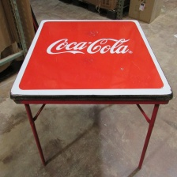
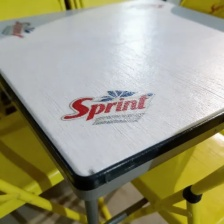
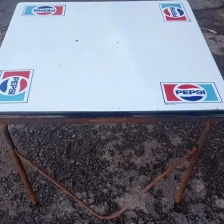
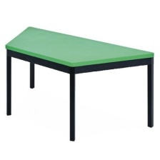
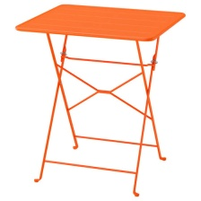
## Su procesamiento en la terminal
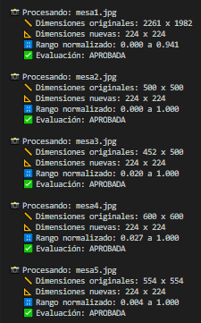

## Sillas
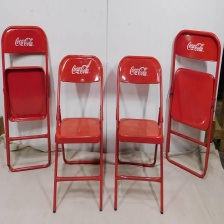
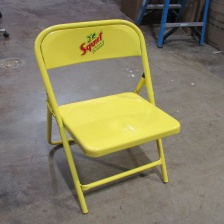
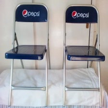
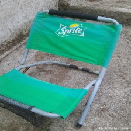
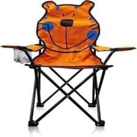
## Su procesamiento en la terminal
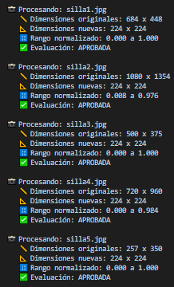

### Resumen de practica 
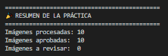

### Resultados en el csv
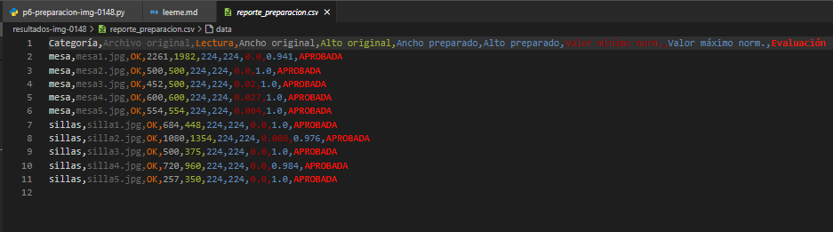